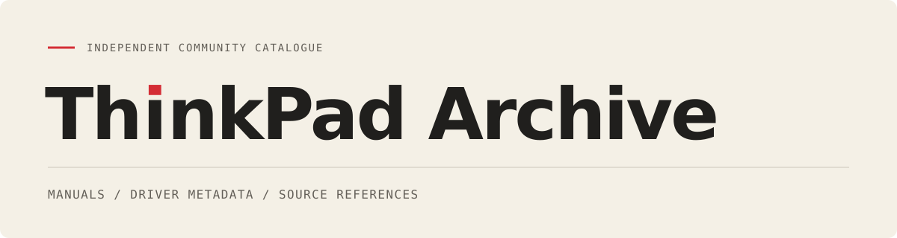

# [](https://thinkpadarchive.com/)

**[Browse the archive](https://thinkpadarchive.com/)** · [Build locally](#build-locally) · [Contribute](#contributing) · [MIT license](LICENSE)

Find manuals, driver metadata and source references for documented ThinkPad models, with an emphasis on early machines. The site is available in English and Spanish. You can also build a local copy and browse it without a server.

**v0.4.4.** Software search and source-listed OS filters, shareable catalogue views, the complete catalogue at the default index and localized social sharing cards. The catalogue is still under development; coverage is documented, not exhaustive. See the [changelog](CHANGELOG.md) for the current scope.

This is an independent community project, not affiliated with, endorsed by or an official publication of IBM or Lenovo.

## In the catalogue

| Content | Indexed entries |
| --- | ---: |
| Documented model entries | 666 |
| Manual and other document references | 489 |
| Driver/software metadata entries | 14,901 |
| Utility references | 10 |

Model pages now include sourced EN/ES summaries, historical context and technical specifications in native collapsible groups. The 666-entry research audit supplies 665 technical profiles and 7,095 facts; 652 profiles contain dated evidence and 239 contain historical prices. These are coverage counts, not worldwide first-launch or universal-price claims. X201si remains unresolved. Compact header metadata omits unsourced prices and shows a market only when exclusivity is explicitly documented; complete source scope remains at the end of each page.

Model pages collect source-supported names and aliases, document links, driver/software listings and provenance. The landing page focuses on the catalogue, without a separate document/utility library. The shared footer contains the independent-community/non-affiliation statement and a creator link to Mikel Calvo. Start with ALL at the left of the timeline to search the complete catalogue and filter by family or available references. Swipe to a year or use the slider for a clean year-only list without search or filters. Entries with unconfirmed years stay in ALL, without a separate timeline option. Grouped variants may appear in more than one documented year. Package metadata includes advertised operating systems, versions and dates where the source provides them. ThinkWiki links are labelled as community references, with an explicit search fallback when no dedicated page has been verified.

These counts describe catalogue records, not unique working downloads or hardware-tested packages. Manufacturer selectors can group variants, and a shared package can appear on several model routes. Missing information stays missing rather than being inferred from a similar model name. The source-backed timeline now reaches 2026. 665 entries have a documented year, including explicitly qualified regional availability and commercial-listing dates. A22m type 2633 remains undated; 750CSE and 1400/2651 remain unverified selector members. See the [0.3.2 historical backfill](docs/year-backfill-0.3.2.md) for the seven added variant years and their limits, alongside the [data-quality review and explicit selector errata](docs/data-quality.md) and the [catalogue schema and evidence levels](docs/catalogue.md).

The Sources page groups IBM/Lenovo documentation, PSREF specifications and ThinkWiki community research into compact entry points. Short evidence definitions and an installation/firmware caution stay visible; the original reference list and coverage/methodology remain available in native disclosures. Source-specific qualifications stay on each model page.

### Before installing historical software

Read the exact package README. Check machine type/model (MTM), variant, operating system, architecture, device and dependencies. A source listing does not guarantee that a link is still live or that a package applies to your machine.

**BIOS, embedded-controller, recovery and destructive utilities require separate care.** They are not routine driver updates. The site does not run downloads, automate installation or certify compatibility. Documentation review and content hashes are not hardware tests.

## Build locally

You need Python 3.11 or later. The builder uses only the standard library. From the project directory:

```sh
python3 -m unittest discover -s tests -v
mkdir -p build
python3 -m thinkpad_archive build --output build/public
python3 tools/check_site.py build/public
```

The output destination must not already exist. Open `build/public/index.html` in your browser, including through `file://`. Pages and links work without JavaScript; optional search and filters run on your device. External manual, source and package links still need Internet access. Modern-browser checks do not establish support for every historical browser.

To make Spanish the root language:

```sh
python3 -m thinkpad_archive build --output build/spanish --default-language es
```

The navigation places catalogue/source links on the left and the globe language picker beside the theme and GitHub controls on the right. Subpages use a compact house icon to return home. The neutral entry starts in English by default and remembers an explicit language choice; direct English/Spanish links remain in their requested language. Switching languages keeps the current model, selected year or sources page. Both builds contain metadata and links, not manufacturer documents or installer binaries. The moon/sun control remembers your theme in local browser storage; on a first visit it starts dark, independent of your system preference. A saved light or dark choice takes priority; without scripts the site also starts dark. GitHub and external references open in a new tab, while catalogue navigation stays in the current one.

## Search, shareable navigation and social cards (0.4.4)

Model pages add optional software search and a source-listed operating-system filter. Known OS label spellings are grouped for navigation; each package still displays the original source text, architecture and evidence. An OS filter is not a compatibility certification. Firmware remains separate and is never hidden by software filters. Without scripts, the original complete category lists remain readable.

Catalogue search, family, reference-presence filters and selected year can be shared in the URL. Reload and browser Back/Forward restore that view. Year views retain their clean, filter-free layout; choose ALL to search across the catalogue. These improvements run locally without accounts, network requests or server-side saved searches.

Shared links include static Open Graph and X/Twitter large-card metadata, localized descriptions, page-specific model/year/source titles, canonical URLs and original EN/ES 1200×630 PNG artwork. The metadata uses the official HTTPS domain; local previews let you inspect the files, but social services cannot fetch localhost. The neutral and legacy catalogue entries use the language-specific default catalogue as their canonical URL. Public sharing services can fetch the deployed files, but their cached previews may take time to refresh; local copies cannot be fetched from localhost. Filter query strings retain their interactive behavior but use the page's unfiltered metadata; static crawlers do not execute the local search. No social SDK, account, tracker or automatic post is added. Normal builds copy the checked-in cards without dependencies; `tools/generate_social_cards.py` is an optional artwork-regeneration tool requiring Pillow, rsvg-convert and DejaVu Sans.

## Hosting

The public site is at **[thinkpadarchive.com](https://thinkpadarchive.com/)**. You can host the generated files on a static web server, or use the included Docker setup. See the [deployment guide](docs/deployment.md) for container hosting and Coolify configuration.

## Contributing

Corrections, source links and translations are welcome. Please include the exact model or machine-type qualifier and the source URL; prefer primary manufacturer sources. Keep grouped source identities intact unless a reliable source establishes an individual variant. Do not assign packages by family-name resemblance.

For a new language, add a complete locale JSON with the same keys as the existing languages. Translate project interface text and warnings, while preserving original product titles and operating-system identifiers. Do not redistribute or translate a manufacturer document as part of this project.

Before proposing a release, run the tests and link checker, inspect both languages and narrow layouts, and review the [release checklist](docs/release-checklist.md).

## License and source rights

Original project code, documentation, tests, translations and artwork are available under the [MIT License](LICENSE), copyright 2026 MikelCalvo.

The catalogue publishes factual metadata and source links. It does not mirror manufacturer PDFs, driver binaries, original README bodies or captured websites, and it contains no personal inventory or local-device records. The project license does not grant rights to third-party documents, software, websites or trademarks. Public availability and content hashes are not redistribution permission.

See [sources, attribution and publication boundary](docs/sources-and-rights.md) for the full distinction. ThinkPad, IBM, Lenovo and other product names belong to their respective owners.
